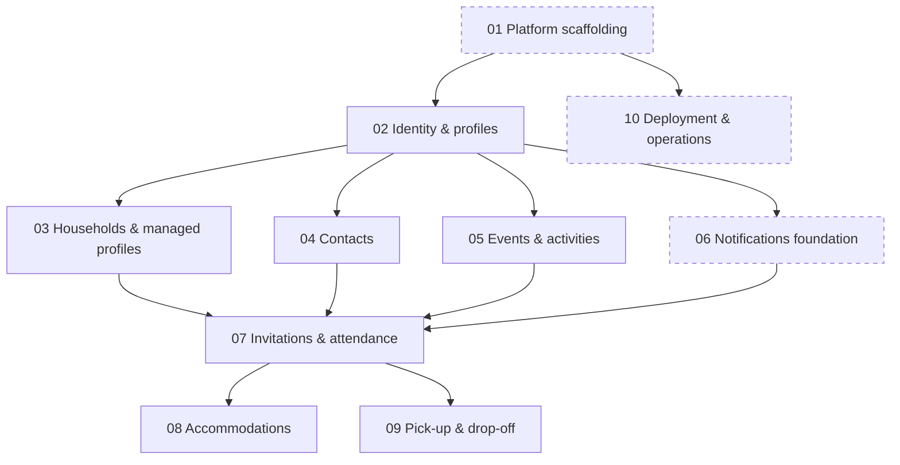

# evie Gameplan

evie makes it easy to create and manage events, especially private "family & friends" events.
An **event** contains one or more **activities** (e.g. *Christmas* → Christmas Eve, Christmas Day, Boxing Day).
Users can be **organizers** (event admins), **hosts** (provide locations and accommodations) and **attendees**, in any combination.
What sets evie apart is **accommodations**: hosts offer places to sleep, and attendees book into them.
A later feature adds **pick-up and drop-off** rides.

This document is the living index of the gameplan. Each stage has a spec in [`gameplan/`](gameplan/) with its
requirements, desired outcome, scope and milestones. Update the status table whenever a stage starts or finishes.

## Tech stack
- **Frontend:** SolidStart + shadcn/ui (Solid port), responsive web app. The SolidStart server acts as a BFF.
- **Backend:** Rust, Tokio, Tonic (gRPC), SeaORM.
- **Database:** PostgreSQL.
- **Auth:** external OIDC identity provider.
- **Repo & tooling:** a single monorepo managed with moonrepo; deployed as Docker containers (hosting TBD).

## Rules for all stages
- **i18n:** every user-facing text is available in German and English.
- **Accessibility:** best effort, with family-friendly UX in mind (clear language, large touch targets, simple flows).
- **Acting on behalf of others:** from stage 03 on, every participation feature supports acting for household members and managed profiles, and records who did it.
- **Accounts required:** all digital participants have an account. Non-digital people are represented by managed profiles.
- **Out of scope for now:** native mobile apps, chat, bring lists, cost sharing.

## Stage DAG

Dashed boxes are horizontal (technical) stages; all others are vertical (domain) slices.

## Status

Legend: ⏳ pending · 🚧 in progress · ✅ done

| ID | Stage | Kind | Depends on | Status |
|----|-------|------|------------|--------|
| 01 | [Platform scaffolding](gameplan/01-platform-scaffolding.md) | horizontal | — | ⏳ |
| 02 | [Identity & profiles](gameplan/02-identity-profiles.md) | vertical | 01 | ⏳ |
| 03 | [Households & managed profiles](gameplan/03-households-managed-profiles.md) | vertical | 02 | ⏳ |
| 04 | [Contacts](gameplan/04-contacts.md) | vertical | 02 | ⏳ |
| 05 | [Events & activities](gameplan/05-events-activities.md) | vertical | 02 | ⏳ |
| 06 | [Notifications foundation](gameplan/06-notifications-foundation.md) | horizontal | 02 | ⏳ |
| 07 | [Invitations & attendance](gameplan/07-invitations-attendance.md) | vertical | 03, 04, 05, 06 | ⏳ |
| 08 | [Accommodations](gameplan/08-accommodations.md) | vertical | 07 | ⏳ |
| 09 | [Pick-up & drop-off](gameplan/09-pickup-dropoff.md) | vertical | 07 | ⏳ |
| 10 | [Deployment & operations](gameplan/10-deployment-operations.md) | horizontal | 01 | ⏳ |

A stage can start once every stage it depends on is ✅. Stages without dependencies on each other (e.g. 03–06) can run in parallel.

## Adding a stage
1. Create `gameplan/NN-<slug>.md` with the next free ID.
2. Use the four required sections: **Requirements**, **Desired outcome**, **Scope** (in / out) and **Milestones**. Add **Open questions** if needed.
3. Prefer a vertical (domain) slice. Use a horizontal stage only if it unblocks vertical work.
4. Add the stage to the Mermaid DAG (one edge per requirement) and to the status table.
5. Mark the stage's status here, and in its spec, as work starts and finishes.
