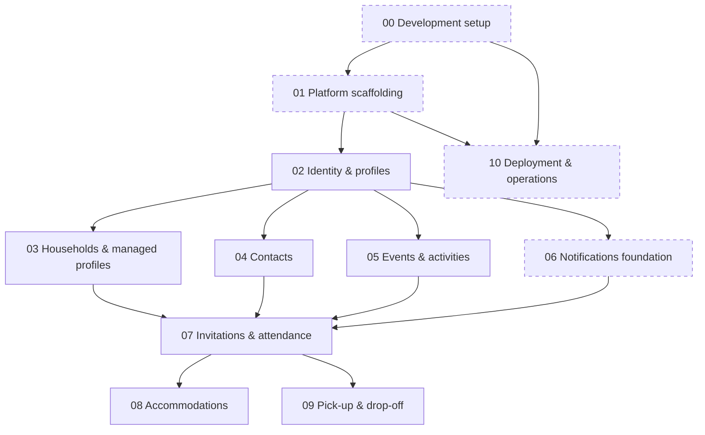

# evie Gameplan

evie makes it easy to create and manage events, especially private "family & friends" events.
An **event** contains one or more **activities** (e.g. _Christmas_ → Christmas Eve, Christmas Day, Boxing Day).
Users can be **organizers** (event admins), **hosts** (provide locations and accommodations) and **attendees**, in any combination.
What sets evie apart is **accommodations**: hosts offer places to sleep, and attendees book into them.
A later feature adds **pick-up and drop-off** rides.

This document is the living index of the gameplan. Each stage has a spec in this folder with its
requirements, desired outcome, scope and milestones. Update the status table whenever a stage starts or finishes.

## Tech stack

- **Frontend:** SolidStart + shadcn/ui (Solid port), responsive web app, written in idiomatic Effect. The SolidStart server acts as a BFF.
- **Backend:** Rust, Tokio, Tonic (gRPC), SeaORM.
- **Database:** PostgreSQL. SeaORM owns the domain schema; Drizzle (BFF) owns the `auth` schema. No foreign keys cross between them.
- **Auth:** BetterAuth in the BFF (email/password, stateful sessions), persisted via Drizzle. External identity providers can be added later as plugins.
- **Repo & tooling:** a single monorepo managed with moonrepo; deployed as Docker containers (hosting TBD). The repo holds **apps** (each produces a deployable Docker image) and **libraries** (consumed by apps, never deployed).
- **Releases:** one repository-wide SemVer version, managed by release-please from Conventional Commits (see stage 00).
- **Agent tooling:** root and per-project `AGENTS.md` files, Agent Skills in `.agents/skills`, and Claude Code subagents (see stage 00).

## Rules for all stages

- **i18n:** every user-facing text is available in German and English.
- **Accessibility:** best effort, with family-friendly UX in mind (clear language, large touch targets, simple flows).
- **Acting on behalf of others:** from stage 03 on, every participation feature supports acting for household members and managed profiles, and records who did it.
- **Accounts required:** all digital participants have an account. Non-digital people are represented by managed profiles.
- **Commits & releases:** PRs are squash-merged with a Conventional Commit title. Before v1, only the PR that completes a release goal is a `feat` (see [Release goals](#release-goals)). New apps follow the stage 00 "Adding an app" checklist.
- **Agent support:** each stage adds or updates the `AGENTS.md` files and skills for the workflows it introduces.
- **Out of scope for now:** native mobile apps, chat, bring lists, cost sharing.

## Stage DAG

Dashed boxes are horizontal (technical) stages; all others are vertical (domain) slices.

## Status

Legend: ⏳ pending · 🚧 in progress · ✅ done

| ID  | Stage                                                                | Kind       | Depends on     | Release goals | Status |
| --- | -------------------------------------------------------------------- | ---------- | -------------- | ------------- | ------ |
| 00  | [Development setup](./00-development-setup.md)                       | horizontal | —              | v0.1, v0.2    | ⏳     |
| 01  | [Platform scaffolding](./01-platform-scaffolding.md)                 | horizontal | 00             | v0.2, v0.3    | ⏳     |
| 02  | [Identity & profiles](./02-identity-profiles.md)                     | vertical   | 01             | v0.3          | ⏳     |
| 03  | [Households & managed profiles](./03-households-managed-profiles.md) | vertical   | 02             | v0.5          | ⏳     |
| 04  | [Contacts](./04-contacts.md)                                         | vertical   | 02             | v0.5          | ⏳     |
| 05  | [Events & activities](./05-events-activities.md)                     | vertical   | 02             | v0.6          | ⏳     |
| 06  | [Notifications foundation](./06-notifications-foundation.md)         | horizontal | 02             | v0.6          | ⏳     |
| 07  | [Invitations & attendance](./07-invitations-attendance.md)           | vertical   | 03, 04, 05, 06 | v0.7          | ⏳     |
| 08  | [Accommodations](./08-accommodations.md)                             | vertical   | 07             | v1            | ⏳     |
| 09  | [Pick-up & drop-off](./09-pickup-dropoff.md)                         | vertical   | 07             | v2            | ⏳     |
| 10  | [Deployment & operations](./10-deployment-operations.md)             | horizontal | 00, 01         | v0.4, v0.8    | ⏳     |

A stage can start once the milestones listed in its **Requirements** are done; the stages it depends on don't have to be ✅ yet. Stages without dependencies on each other (e.g. 03–06) can run in parallel.

## Release goals

Development is organized into release goals. Each goal is a version, delivers one or more stage milestones and is tracked as a GitHub milestone. Goal numbers don't match stage numbers: a goal can span several stages, and a stage can be split across several goals. Like the stages, the goals change as the project evolves: they can be added, deferred, merged or re-cut.

- **GitHub milestone:** one per goal, titled `vX.Y - <goal name>` (e.g. `v0.2 - Monorepo setup`, `v2 - Pick-up and drop-off`). Its description holds the goal's description and the stage milestones it targets, grouped by stage ([template](../templates/github-milestone.md)).
- **Issues:** each stage milestone becomes one or more issues in the goal's GitHub milestone ([template](../templates/github-issue.md)). Issues start as rough outlines and are refined before implementation.
- **Sub-issues** are only created while planning the implementation of a single issue, to split its work into items that PRs close.
- **Versioning before v1:** every PR is a `fix` (patch). Only the PR that closes the last issue of a goal is a `feat`, which bumps the minor version (e.g. `0.2.x` → `0.3.0`). Breaking changes (`!`) are not used before v1. This deliberately bends SemVer and ends with v1.
- **Major goals:** release-please never reaches `1.0.0` or `2.0.0` from `feat` commits, so the PR that completes v1 or v2 sets the version with a `Release-As: X.0.0` footer. v2 is a deliberate "big feature" major, not a breaking change. From v1 on, normal SemVer applies.

| Goal                            | Description                                                                                                                                   | Targets               |
| ------------------------------- | --------------------------------------------------------------------------------------------------------------------------------------------- | --------------------- |
| v0.1 - Development setup        | Agents and humans share documented conventions, skills and guardrails, and every release is versioned, tagged and changelogged automatically. | 00: 1–8               |
| v0.2 - Monorepo setup           | The monorepo builds the SolidStart frontend and the Rust backend into working Docker images, with a page that shows data from the backend.    | 00: 9 · 01: 1–4, 7, 8 |
| v0.3 - Accounts & profiles      | Users can sign up, sign in, reset their password, manage their profile and delete their account, in German or English.                        | 01: 5, 6 · 02: 1–5    |
| v0.4 - Continuous delivery      | Every merge to main deploys to staging, and agents refine issues, review PRs and open improvement and security PRs on their own.              | 10: 1, 2, 5           |
| v0.5 - Households & contacts    | Users can form households, manage profiles for family members without an account, and build a contact list.                                   | 03: 1–5 · 04: 1–4     |
| v0.6 - Events & notifications   | Organizers can create and publish events with activities, and evie notifies users by email, web push and an in-app inbox.                     | 05: 1–5 · 06: 1–4     |
| v0.7 - Invitations & attendance | Organizers invite people, who respond for themselves and their family and choose their activities.                                            | 07: 1–6               |
| v0.8 - Production environment   | evie runs in production with TLS, monitoring and tested backups, ready for the first real users.                                              | 10: 3, 4              |
| v1 - Accommodations             | Hosts offer places to sleep and attendees book into them. This is the first version for real users.                                           | 08: 1–5               |
| v2 - Pick-up and drop-off       | Attendees request rides, and other participants offer to pick them up or drop them off.                                                       | 09: 1–4               |

Targets are `stage: milestone numbers`. v0.8 can run in parallel with v0.5–v0.7; it only has to be done before v1.

## Adding a stage

1. Create `gameplan/NN-<slug>.md` with the next free ID.
2. Use the four required sections: **Requirements**, **Desired outcome**, **Scope** (in / out) and **Milestones**. Add **Open questions** if needed.
3. Prefer a vertical (domain) slice. Use a horizontal stage only if it unblocks vertical work.
4. Add the stage to the Mermaid DAG (one edge per requirement) and to the status table.
5. Assign its milestones to one or more release goals, and update the GitHub milestones and issues.
6. Mark the stage's status here, and in its spec, as work starts and finishes.
